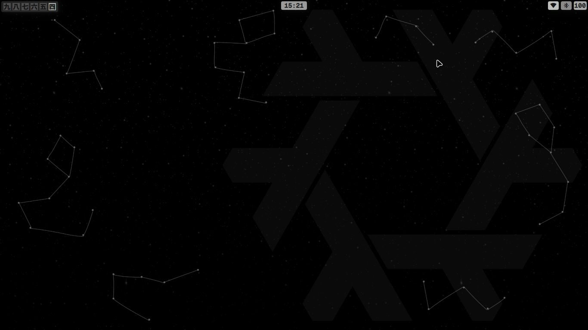
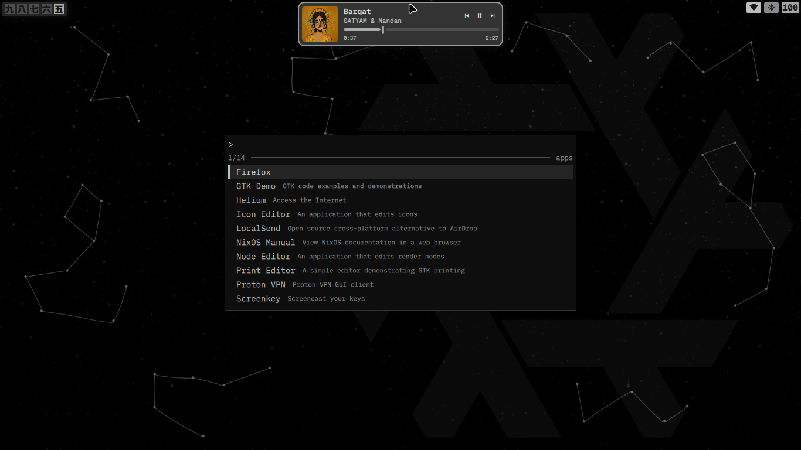
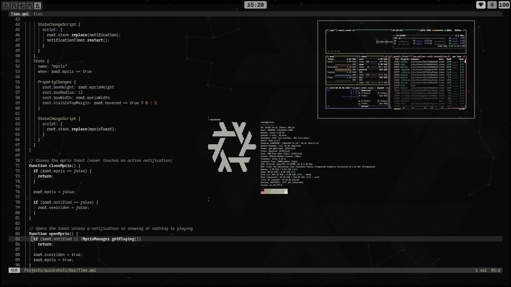

<div align="center">


**inerM config: minimal yet functional**


A small, dendritic NixOS flake with an optional ephemeral root.




  
</div>

---

## What's inside

- **Flakes + flake-parts**: every `.nix` file is auto-imported (dendritic style)
- **niri** + a custom **Quickshell** bar and launcher
- **Impermanence**: tmpfs root, wiped each boot (on by default, easy to switch off)
- **sops-nix** for passwords, **wrapped** programs, Monochrome theme, IBM Plex

## Keybindings

| Keys | Action |
| :--- | :--- |
| <kbd>Mod</kbd> <kbd>Space</kbd> | App launcher |
| <kbd>Mod</kbd> <kbd>Alt</kbd> <kbd>Space</kbd> | File launcher |
| <kbd>Mod</kbd> <kbd>Shift</kbd> <kbd>V</kbd> | Clipboard history |
| <kbd>Mod</kbd> <kbd>.</kbd> | Emoji picker |
| <kbd>Mod</kbd> <kbd>Enter</kbd> | Terminal (`kitty`) |
| <kbd>Mod</kbd> <kbd>Q</kbd> | Close window |
| <kbd>Mod</kbd> <kbd>F</kbd> / <kbd>G</kbd> | Maximize column / Fullscreen |
| <kbd>Mod</kbd> <kbd>Shift</kbd> <kbd>F</kbd> | Toggle floating |
| <kbd>Mod</kbd> <kbd>Tab</kbd> | Overview |
| <kbd>Mod</kbd> <kbd>H J K L</kbd> | Focus (add <kbd>Shift</kbd> to move) |
| <kbd>Mod</kbd> <kbd>1</kbd>-<kbd>0</kbd> | Workspaces (add <kbd>Shift</kbd> to send window) |

More in `packages/niri.nix`. Launcher modes are documented in the [quickshell config](https://codeberg.org/inerM/quickshell).

---

## Install

Default host is `potato` (an old Intel laptop, BIOS + GRUB), default user is `inerm`.
Rename or edit both to suit your machine.

### 1. Clone

```bash
git clone https://github.com/inerM/nixos ~/.nixos
cd ~/.nixos
```

`~/.nixos` is already on the persist list, so it survives reboots with impermanence.

### 2. Adjust the host

Everything machine specific lives in `hosts/potato/`:

| File | Change |
| :--- | :--- |
| `_hw.nix` | Replace with your own `nixos-generate-config` output |
| `_boot.nix` | GRUB on `/dev/sda` (BIOS). For UEFI, switch to systemd-boot or GRUB EFI |
| `_locale.nix` | Timezone and locale (`Asia/Kolkata`, `en_US.UTF-8`) |
| `potato_dri.nix` | Old Intel graphics drivers. Swap for your GPU, or drop the import |

To add another machine, copy `hosts/potato/`, rename it, and set a new `networking.hostName`.

### 3. Set up secrets (required)

Passwords come from `sops-nix`, and the committed `secrets/secrets.yaml` is encrypted to **my** key, so you can't decrypt it. Make your own:

```bash
nix shell nixpkgs#age nixpkgs#sops nixpkgs#mkpasswd

age-keygen -o key.txt                 # prints your public key (age1...)
# put that public key in .sops.yaml, replacing the existing one

mkpasswd -m yescrypt                  # run twice: one hash for user, one for root
sops secrets/secrets.yaml             # set user_password and root_password to the hashes
```

Then put the private key where the config expects it, `/persist/sops/key.txt` (see `sops.nix`):

```bash
sudo install -Dm600 key.txt /persist/sops/key.txt   # on a fresh install: /mnt/persist/sops/key.txt
```

The username is set in `users/primaryuser.nix`. Never commit `key.txt` (it's in `.gitignore`).

### 4. Build

```bash
sudo nixos-rebuild build  --flake .#potato     # dry run
sudo nixos-rebuild switch --flake .#potato     # apply
nix flake update                               # update inputs
```

### Fresh install (impermanence)

Partition one ext4 disk (labels `nixos` and `swap` by default, see `impermanence/fs.nix`), mount it at `/mnt/persist`, put the repo and key there, then:

```bash
nixos-install --root /mnt --no-root-passwd --flake /mnt/persist/home/<user>/.nixos#potato
```

> [!NOTE]
> On legacy BIOS machines GRUB can have trouble finding the kernel on a tmpfs root. If that happens u r on ur own bruh. You'll need your own workaround.

### Without impermanence

Remove the `impermanence` line from the module list in `hosts/potato/default.nix`. The config then uses the filesystems from `_hw.nix`. Sops still needs the key file, so create `/persist/sops/key.txt` or change `sops.age.keyFile` in `sops.nix`.

---

## Impermanence

```text
/                  tmpfs, wiped on every boot (2G, my.fs.rootSize)
├── /persist       your real partition, survives
│   └── /nix       bind-mounted to /nix
├── /boot          same partition by default, or my.fs.bootDevice on UEFI
└── ...            everything else is gone after a reboot
```

**Keep something new?** Declare it, rebuild, reboot.

- System paths: add to `preservation.preserveAt."/persist"` in `impermanence/preservation.nix`
- Home paths: add to `my.persist.homeDirectories` or `my.persist.homeFiles`

```nix
my.persist.homeDirectories = [
  { directory = ".ssh"; mode = "0700"; }
];
```

**Check it works:**

```bash
touch /testfile && sudo reboot
ls /testfile            # should be gone
ls /nix/store | wc -l   # should still be thousands
```

Passwords are managed through sops, so `passwd` changes are lost on reboot. Change the hash in `secrets/secrets.yaml` instead.

---

## Structure

```text
.
├── flake.nix            inputs + auto-importer
├── parts.nix            flake-parts setup, systems
├── settings.nix         nix settings, gc, stateVersion
├── sops.nix             secrets config
├── dev.nix              devShells (nixos, python, rust, phone)
├── hosts/potato/        host config, hardware, boot, locale, drivers
├── impermanence/        tmpfs root + preservation
├── OS/                  ui, theme, gtk, services, apps, wallpaper
├── packages/            all apps, wrapped programs (niri, kitty, fish, helix, ...)
├── users/               primary user
└── secrets/             sops-encrypted yaml
```

`flake.nix` imports every `.nix` file in the repo except `flake.nix` itself. Prefix a file with `_` (like `_hw.nix`) to exclude it from auto-import, which is how host-local files are pulled in by hand.

Dev shells: `nix develop` (everything), or `.#nixos`, `.#python`, `.#rust`, `.#phone`.

---

## Apps

Default apps are Kitty, yazi(with yazi file picker/desktop-portal), helium, Launcher(quickshell), helix etc. no gui file manager or file picker is provided(i mean yazi is fast as f.., why do u even need one).
Optionally elio is also provided (with file picker) but by default it is not. to use uncomment elio inputs from `flake.nix` and from `OS/environment.nix`
```nix                                                                        
   63  #       self'.packages.elio  <--- uncomment it                                                                       
    1  │ │ │ ];                    
```

## Look

- **Palette**: inspired by [ryoku](https://ryoku.dev/), monochrome palette `OS/theme.nix`
- **GTK**: Monochrome
- **Font**: IBM Plex (Sans, Serif, Mono)
- **Cursor**: Bibata Modern Classic

## Gallery

```text
to be included, lol
```

## Quickshell

Most Quickshell rices mid, over-animated bloat shit to me, so I forked [voidarc's shell](https://git.voidarc.co.uk/voidarc/quickshell) (Hyprland only) to work on niri, with a multi-function launcher. Details in [inerM/quickshell](https://codeberg.org/inerM/quickshell).

---

## Thanks

- [Vimjoyer](https://github.com/vimjoyer/nixconf) for the dendritic pattern and wrapped programs
- [A Dumb Human](https://git.voidarc.co.uk/voidarc/quickshell) for the original Quickshell config

## License

[MIT](LICENSE)

## A note on AI

>I used AI for debugging, cleanup and code comments. The config itself was written by hand. I'm not against it, but pasting straight from an LLM defeats the point of open community.

This `README.md` was generated by Claude(too much work, lol), so check twice before commiting instructions.
