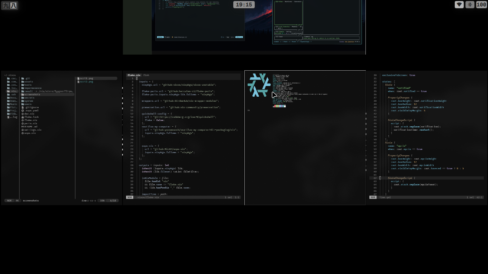

# Minimal Impermanence NixOS Config

> A simple, dendritic, ephemeral root(impermanence) NixOS configuration built with flakes.

---


## Contents

- [Overview](#overview)
- [Keybindings](#keybindings)
- [Installation](#installation)
- [Architecture](#architecture)
- [Impermanence](#impermanence)
- [Hosts & Users](#hosts--users)
- [File Structure](#file-structure)
- [Theming](#theming)
- [QuickShell](#quickshell)
- [Holy Thanks](#holy-thanks)
- [spNotes](#spnotes)

---

## Overview

This configuration is made to be **as minimal as possible**—focusing on reproducibility, and zero unnecessary bloat. It provides a wrapped, modular desktop environment without overhead. It also includes **optional** impermanence (root wiped on every boot,tmpfs). It is off by default for the `potato` host and can be switched on with one uncomment. - [Read](#impermanence)

---

## Keybindings

Necessary window manager shortcuts: discover lot more :)

| Keybinding | Action |
| :--- | :--- |
| <kbd>Mod</kbd> + <kbd>Space</kbd> | Application Launcher |
| <kbd>Mod</kbd> + <kbd>Enter</kbd> | Terminal (`kitty`) |
| <kbd>Mod</kbd> + <kbd>Q</kbd> | Close Window |
| <kbd>Mod</kbd> + <kbd>F</kbd> | Toggle Fullscreen |
| <kbd>Mod</kbd> + <kbd>Shift</kbd> + <kbd>F</kbd> | Toggle Floating / Popup Window |
| <kbd>Mod</kbd> + <kbd>Tab</kbd> | overview desktop |

---
> [!IMP-NOTE]
> Regarding launcher option keybinds refer to the [quickshell-config](https://codeberg.org/inerM/quickshell)

## Installation
>[!IMPORTANT]
>Impermanence is **optional**. if you dont want this skip step 1 and the config works on any normal filesystem.
>for password u need to edit the praimaryuser.nix, comment out the sops, hassedpass aspects.
### 1. Choose: with or without impermanence
- **With impermanence** (tmpfs): refer to [Impermanence](#impermanence)
  ```nix
    		]
  		++ (with self.nixosModules; [ 
	   # impermanence  <------ uncomment this.

  ```
- **Without impermanence**: skip step 1.

### 2. Clone the repository
```bash
git clone https://codeberg.org/inerM/nixos.git ~/<path to your choice>/< eg. ~/nixos/ >
cd ~/<cloned path>
rm -rf .git
```

### 3. Build & Apply
Default host is `potato` (yes my device is the same:)), provided driver packages are for old intel cpu. Configure `system/drivers/potao_dri.nix` as per your system.
>[!IMPORTANT]
>Default `locale`, `bootloader-grub` are en_US(`hosts/potato/_legacy/_locale.nix`), BIOS system respectively. If using UEFI device, must change them accordingly.  
```bash
# Test the configuration (dry-run or build without switching)
nixos-rebuild build --impure --flake .#potato  #if changed hostname then #yourhostname

# Switch configuration
sudo nixos-rebuild switch --impure --flake .#<hostname>

# Update flake inputs
nix flake update
```
`--impure` is must because hardware-configuration vary by devices unless you paste yours in `hosts/potato/hardware-configuration.nix` here, else it will failed to build.

---

## Architecture

The `flake.nix` dynamic loader automatically discovers and imports configuration files:

- **Auto-Import**: All files inside the config directory are automatically imported into the flake outputs.
- **Ignored / Excluded**:
  - `flake.nix`
  - `flake.lock`
  - Any file prefixed with an underscore (`_`)

To temporarily disable a module or keep private templates unparsed, simply prefix the filename with an underscore (e.g., `_module.nix`).

### filetree 
```text
will include later (its unnecessary anyway for a dendritic setup )
```

---

## Impermanence
switched to lot simpler tmpfs root. to use it you must have to have only one partion where whole `/`resides.
the `/boot` are mounted at `/persist` during boot so that it wont crash into emergency mode.
>[!note]
>during installation you might encounter grub not finding kernel in legacy BIOS devices. You need to find workaround to fix that.

## structure
```text
.
└── /    <---- except the /persist whole section is going to wipe on boot/
    ├── /bin
    ├── /boot
    ├── /etc
    ├── /persist/
    │   ├── /boot   <----- the /boot is mounted here so it wont wipe
    │   └── /nix    <------ same for it. you can preserve more . see the preservance.nix
    ├── /var
    └── /nix
```
## Install
```bash
nixos-install --root /mnt --no-root-passwd --impure --flake /mnt/persist/home/<user>/.nixos#<hostname>
```

### Using it

**Persist something new.** If something vanishes after a reboot, declare it in `preservation.nix`:
- System path: add it to `preserveAt."/persist".directories` or `files` (for example `"/var/lib/NetworManager"` if you use iwd).
- Home path: add it to `my.persist.homeDirectories` or `homeFiles`, for example `".config"` or `{ directory = ".ssh"; mode = "0700"; }`.

Then rebuid and reboot.

**Test that it works.**
```bash
touch /testfile && sudo reboot
ls /testfile            # should not exist
ls /nix/store | wc -l   # should still be thousands
```

**Troubleshooting.**: 
No idea dude, mine worked so you are on your own.

## Hosts & Users
Default host: `potato`, username: `inerm`, password: `dihh`.
Change the username or password in `nodes/users/primaryuser.nix` if you wish.

> [!WARNING]
> Without impermanence you can change the password with `passwd` after the first rebuild. **With impermanence, `passwd` is wiped on reboot**, so change it in `nodes/users/primaryuser.nix` instead (use a hash from `mkpasswd -m yescrypt`, or a `hashedPasswordFile` on `/persist`).

### Hosts
- **`potato`**:  main host have all features. 
- **`<host-2>`**:   make one if you want multiple machines config.

### Users
- **`dihh`**:  main user. 

---

## Theming

Colorscheme is taken from [Vimjoyer's](https://github.com/vimjoyer/nixconf/blob/main/theme.nix). this muted color palette maybe the best among i have used so far.
Font is `IBM Plex Sans` and cursor is `Bibata Modern classic`. More theming option will include later. (im bad with colors, lol)

---

## QuickShell

All the viral Qs rices are mid, overanimated, funky or in berif, type of shii. (imo)
So I forked [A Dumb Human's](https://git.voidarc.co.uk/voidarc/quickshell)(voidarc's) shell, which was made only for hyprland, to make it work for niri.
A cool multifuntion launcher is included.
for Detailed info read [Quickshell-config](https://codeberg.org/inerM/quickshell)

## Holy Thanks

Special thanks to:
- [Vimjoyer](https://github.com/vimjoyer/nixconf) — for the foundational dendritic pattern and wrapped programmes, specially neovim.
- [A Dumb Human](https://git.voidarc.co.uk/voidarc/quickshell) — for quickshell.

## SpNotes
Reguarding AI , i did use ai for debugging, code: cleanup, commenting etc usecaes. `the config is not made by Ai.` I am not against using ai but copy-pasting from LLM kills the purpose of open community.
In the config you migh encounter comments in the code files which are for repo understanding pupose, in some minute areas doing maually will take ages. thats where i used ai to code cleanup and inserting understandable commets.
thanks..
